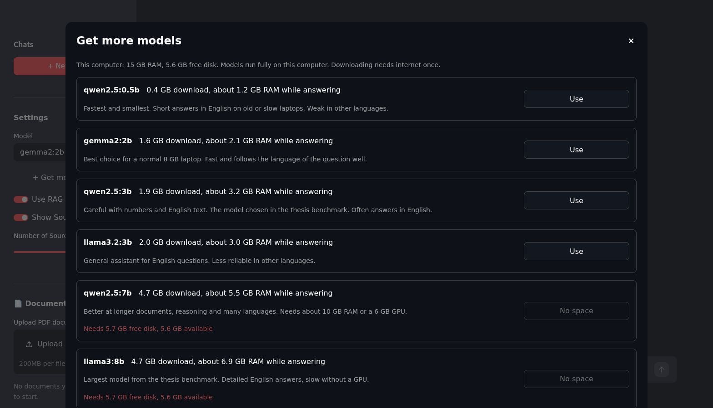

# Offline Multilingual RAG for Your Documents

Ask questions about your own PDFs and get answers that come only from those documents. Everything runs on your own machine: no cloud, no API keys, and no document ever leaves the computer. It works with documents and questions in different languages, and it runs on an ordinary 8 GB laptop without a GPU.

This is the system from my bachelor thesis, *Development of a Multilingual RAG System for Enterprise Documentation*. It is open source so anyone can run it on their own documents and adapt it to their own setup.


*The screenshots use [a fictional company handbook](docs/example/northwind_handbook.pdf) written in English. Questions asked in Arabic and German are answered in the language of the question. The last question is not covered by the document, so the system says so instead of guessing.*

## What it does

- **Answers only from your documents.** The prompt forbids the model from using its own knowledge. If the answer is not in the documents, it replies that the documents do not contain this information.
- **Any language.** The question, the document and the answer do not have to share a language. A question in Arabic about an English PDF gets an Arabic answer.
- **Shows its sources.** Every answer lists the passages it used, with file name and page, and you can open each one to read the exact text.
- **Private by design.** Uploaded PDFs and their index live only in memory. Chats are not saved and disappear when the browser session ends. Ollama cloud models are hidden from the model list, so documents are never sent to a server.
- **Pick the right model for the job.** "Get more models" lists recommended local models with what each one is good for. It checks this computer's RAM and free disk and only offers models that will run, then downloads them with a progress bar. You can switch models at any time, even inside one chat, and every answer shows which model wrote it.
- **Runs on modest hardware.** The default setup needs about 4.5 GB of RAM in total (measured on a CPU only laptop).




## How it works


1. **Upload.** One or more PDFs are uploaded in the sidebar and kept in RAM.
2. **Extract and clean.** pypdf extracts the text of every page. Regex rules remove page numbers, join broken lines and repair Arabic letters that some PDF fonts store in the wrong order.
3. **Chunk.** A sliding window splits the text into chunks of 500 characters with 150 characters of overlap, so a sentence cut at a border is still complete in the neighbouring chunk.
4. **Embed and index.** A multilingual embedding model (BAAI/bge-m3) turns every chunk into a vector, stored in a FAISS IndexFlatIP index (cosine similarity on normalized vectors).
5. **Retrieve.** The question is embedded with the same model. Vector search and BM25 keyword search each rank the chunks, and Reciprocal Rank Fusion combines both rankings. An optional cross-encoder reranker can reorder the best candidates.
6. **Build the prompt.** The top chunks go into a strict prompt that allows only facts from the passages. The prompt also contains an outline of the whole document (its headings, found at upload), so questions like "what does this document cover?" are answered from all topics, not only from the closest passages. Documents short enough to fit in the prompt are sent completely. Only the latest question and answer of the chat are included (rolling window), which keeps the prompt short.
7. **Generate.** A local 4-bit model answers through Ollama on the CPU, streamed word by word.
8. **Check the language.** If a small model answers in the language of the passages instead of the question, the answer is translated into the question's language by the same local model.

## Results

From the thesis benchmarks on an Intel Core i7 laptop with 8 GB RAM and no GPU, using 4-bit models in Ollama:

| Model | Answer time | Peak RAM | Speed |
|---|---|---|---|
| Qwen2.5 0.5B | 8.45 s | 1.15 GB | 18.2 tok/s |
| Qwen2.5 3B | 24.16 s | 3.22 GB | 6.8 tok/s |
| Llama3 8B | 41.38 s | 6.85 GB | 2.4 tok/s |

- **Memory:** with Llama3 8B the whole system needed 9.30 GB and went past the 8 GB limit. The smaller models fit with room to spare.
- **Response time:** sending the full chat history made the prompt grow with every turn, and answers took up to 60 s. The rolling window brought this down to about 4 s in the thesis tests.
- **Grounding:** with retrieval turned off, the model invented server paths and passwords for a question the document did not cover. With retrieval on, it answered that the information was not in the document.


**Default model.** After the thesis I compared the installed small models on multilingual questions. gemma2:2b followed the question's language and copied facts more reliably than qwen2.5:3b and llama3.2:3b, and it is smaller, so it is now the default. Any Ollama model can be selected in the sidebar.

## Getting started

### Requirements

- [Ollama](https://ollama.com) installed and running
- Python 3.10 or newer
- About 3 GB of disk space for the embedding model and 2 GB for the language model

### Install

```bash
git clone https://github.com/omar-radwan7/Rag-System-for-an-LLM-.git
cd Rag-System-for-an-LLM-
python -m venv venv
source venv/bin/activate
pip install -r requirements.txt
ollama pull gemma2:2b
```

### Run

```bash
streamlit run ui/app.py
```

Open the address Streamlit prints, upload a PDF in the sidebar and ask a question. The embedding model is downloaded once on first use. After that, everything works offline.

## Configuration

All settings are in `config.json`:

| Key | Meaning |
|---|---|
| `chosen_model` | Default Ollama model (any installed model can also be picked in the sidebar) |
| `allow_model_downloads` | Shows the "Get more models" button. Set it to `false` if IT should control which models are installed |
| `embedding_model` | Sentence Transformers model for the vectors. `intfloat/multilingual-e5-small` is a lighter option |
| `reranker_model` | Optional cross-encoder, for example `BAAI/bge-reranker-v2-m3`. Off by default because it adds about 2.5 GB of RAM and several seconds per question |
| `chunk_size_chars`, `chunk_overlap_chars` | Sliding window size and overlap |
| `top_k_retrieval` | Default number of passages per answer |
| `full_context_chars` | Documents up to this many characters are sent to the model completely instead of only the top passages |

## Evaluate on your own documents

Write a few questions with expected answers (see `eval/gold_questions.example.json`) and run:

```bash
python eval/eval_runner.py your_document.pdf --gold your_questions.json
```

It compares the model alone with the model plus retrieval and writes the results to `results/`.

## Project structure

```
rag/
  pdf_indexer.py     PDF extraction, cleanup, chunking, in-memory FAISS index
  rag_pipeline.py    Hybrid retrieval, strict prompt, rolling window, language check
  keyword_search.py  BM25 and Reciprocal Rank Fusion
  arabic_fix.py      Repairs Arabic letters swapped by PDF extraction
  models.py          Embedding model prefixes (e5 vs others)
  model_catalog.py   Recommended models, RAM and disk checks
  ollama_client.py   Local Ollama API
ui/
  app.py             Streamlit interface
eval/
  eval_runner.py     LLM only vs RAG on your documents
docs/
  example/           Fictional handbook used in the screenshots
config.json
```

## Background

The project started during my internship at the Applied Innovation Center (AIC), where the goal was a question answering bot for an Egyptian Arabic novel. I built that version, and after the internship I turned it into a general tool: any documents, any language, and answers strictly limited to what the documents say. The bachelor thesis describes and evaluates this version.

## License

MIT License
