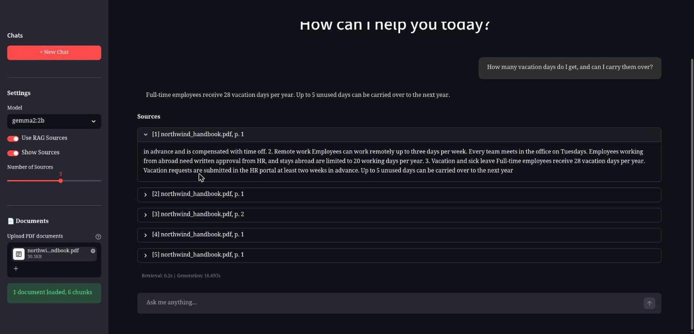
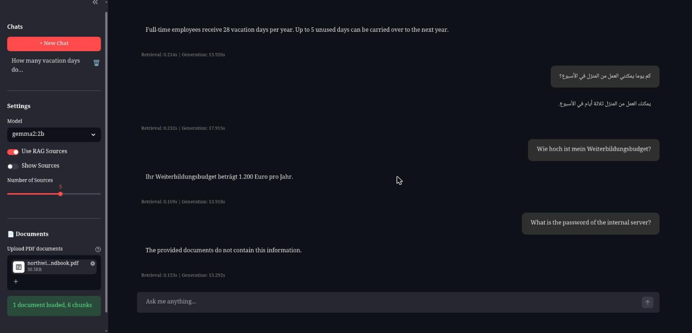
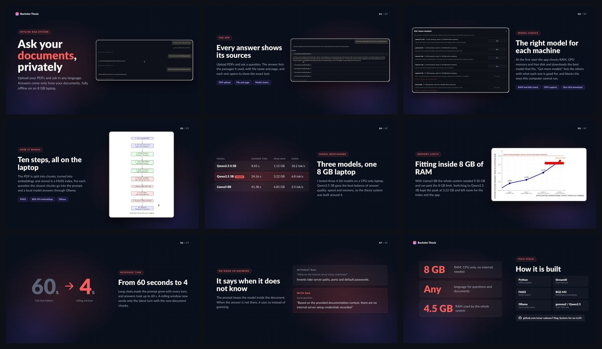
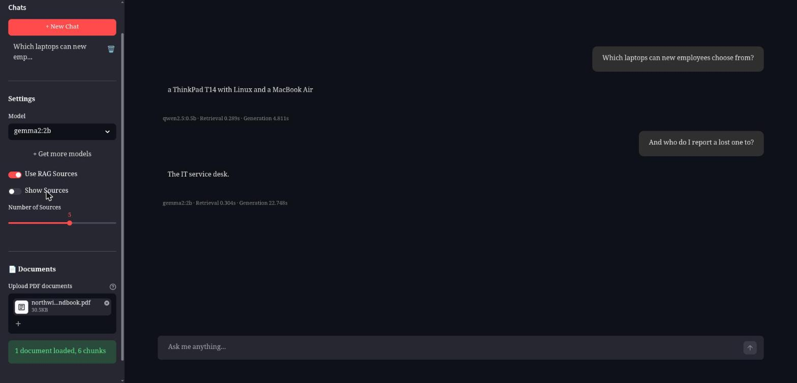
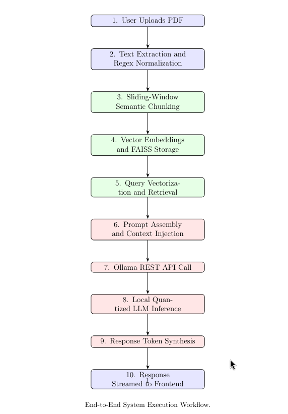
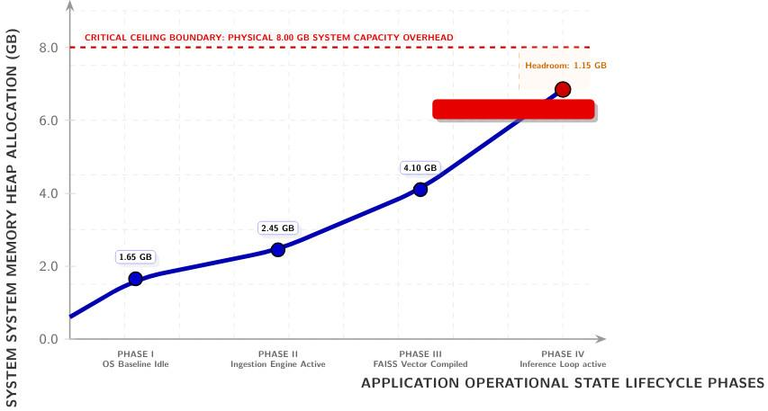

# Offline AI assistant that answers employee questions from company PDFs, with sources, in any language. Bachelor thesis.

**Employees ask questions about company PDFs and get answers with sources, in their own language. Everything runs on the company's own computers: no cloud, no API keys, and no document ever leaves the machine.**


Bachelor thesis project: *Development of a Multilingual RAG System for Enterprise Documentation*.
[Slides (PDF)](docs/slides/RAG_Thesis_Slides.pdf) · [Getting started](#getting-started) · [Results](#results) · [How it works](#how-it-works)



## Why

Many companies cannot paste internal documents into a cloud chatbot. Handbooks, contracts and process descriptions contain personal and confidential data. This assistant brings the same kind of help onto the company's own hardware:

- **Private.** Documents, questions and answers stay on the machine. Uploaded PDFs live only in memory and disappear when the session ends.
- **Grounded.** The model may answer only from the uploaded documents. When the answer is not there, it says so instead of guessing.
- **Traceable.** Every answer lists the passages it used, with file name and page.
- **Multilingual.** The question, the document and the answer do not have to share a language. A question in Arabic about an English PDF gets an Arabic answer.
- **Modest hardware.** It runs on an ordinary 8 GB laptop without a GPU, and uses a stronger model when the machine has more RAM or a GPU.



*The screenshots use [a fictional company handbook](docs/example/northwind_handbook.pdf) written in English. Questions in Arabic and German are answered in the language of the question. The last question is not covered by the document, so the assistant says so.*

## Presentation

The thesis presentation gives a short tour of the app, the model choice, the pipeline and the benchmark results.

[](docs/slides/RAG_Thesis_Slides.pdf)

**[Open the slides (PDF, 9 pages)](docs/slides/RAG_Thesis_Slides.pdf)**

## Getting started

Clone the repository, then start it with one command.

```bash
git clone https://github.com/omar-radwan7/Rag-System-for-an-LLM-.git
cd Rag-System-for-an-LLM-
```

### Option 1: Docker (same setup on every machine)

Needs only [Docker](https://docs.docker.com/get-docker/).

```bash
docker compose up
```

This starts Ollama and the app in containers, downloads the best model for the machine once, and serves the app at http://localhost:8501. Models and the embedding model are kept in Docker volumes, so later starts are fast. Plan for about 9 GB of disk.

With an NVIDIA GPU and the [NVIDIA Container Toolkit](https://docs.nvidia.com/datacenter/cloud-native/container-toolkit/install-guide.html):

```bash
docker compose -f docker-compose.yml -f docker-compose.gpu.yml up
```

### Option 2: run script (no Docker)

Needs [Ollama](https://ollama.com/download) and Python 3.10 to 3.13.

```bash
./run.sh        # Linux and macOS
run.bat         # Windows
```

On the first run the script creates a Python environment in `.venv`, installs the pinned package versions (on Linux the CPU build of PyTorch, which saves about 3 GB), starts Ollama if needed and downloads the best model for the machine. Ollama uses an NVIDIA or Apple Silicon GPU on its own. Later runs start the app directly.

Upload a PDF in the sidebar and ask a question. The embedding model (about 2.2 GB) is downloaded once on the first upload. After that, everything works offline.

### Which model a machine gets

A strong machine should not start with the small model a weak laptop needs. Both setup options check RAM, NVIDIA GPU memory and free disk, and download the best model that fits:

| Machine | First model |
|---|---|
| Up to 6 GB RAM | qwen2.5:0.5b |
| 6 to 10 GB RAM | gemma2:2b |
| 10 GB RAM or more | qwen2.5:7b |
| NVIDIA GPU with 6 GB or more | qwen2.5:7b, on the GPU |

If the disk is too small for a model, the next smaller one is used. In the app, "Get more models" lists the other recommended models with what each one is good for, and only offers the ones this computer can run. You can switch models at any time, even inside one chat, and every answer shows which model wrote it.

To fix one model for everyone, for example when IT decides, set `chosen_model` in `config.json` to its name instead of `"auto"`. To see what a machine would get: `python -m rag.model_catalog --recommend`.

The rules were tested with simulated hardware values (`--ram`, `--gpu`, `--disk`). Answer quality of the larger models was not measured, since the development laptop cannot run them at a usable speed.




To use an Ollama server on another machine, set `OLLAMA_URL`, for example `OLLAMA_URL=http://192.168.1.20:11434 ./run.sh`. `PORT` changes the app's port.

## How it works



1. **Upload.** One or more PDFs are uploaded in the sidebar and kept in RAM.
2. **Extract and clean.** pypdf extracts the text of every page. Regex rules remove page numbers, join broken lines and repair Arabic letters that some PDF fonts store in the wrong order.
3. **Chunk.** A sliding window splits the text into chunks of 500 characters with 150 characters of overlap, so a sentence cut at a border is still complete in the neighbouring chunk.
4. **Embed and index.** A multilingual embedding model (BAAI/bge-m3) turns every chunk into a vector, stored in a FAISS IndexFlatIP index (cosine similarity on normalized vectors).
5. **Retrieve.** The question is embedded with the same model. Vector search and BM25 keyword search each rank the chunks, and Reciprocal Rank Fusion combines both rankings. An optional cross encoder reranker can reorder the best candidates.
6. **Build the prompt.** The top chunks go into a strict prompt that allows only facts from the passages. The prompt also contains an outline of the whole document (its headings, found at upload), so questions like "what does this document cover?" are answered from all topics. Documents short enough to fit are sent completely. Only the latest question and answer of the chat are included (rolling window), which keeps the prompt short.
7. **Generate.** A local 4 bit model answers through Ollama, on the CPU or the GPU, streamed word by word.
8. **Check the language.** If a small model answers in the language of the passages instead of the question, the answer is translated into the question's language by the same local model.

## Results

Thesis benchmarks on an Intel Core i7 laptop with 8 GB RAM and no GPU, using 4 bit models in Ollama:

| Model | Answer time | Peak RAM | Speed |
|---|---|---|---|
| Qwen2.5 0.5B | 8.45 s | 1.15 GB | 18.2 tok/s |
| Qwen2.5 3B | 24.16 s | 3.22 GB | 6.8 tok/s |
| Llama3 8B | 41.38 s | 6.85 GB | 2.4 tok/s |

- **Memory.** With Llama3 8B the whole system needed 9.30 GB and went past the 8 GB limit. The smaller models fit with room to spare. The default setup needs about 4.5 GB of RAM in total.
- **Response time.** Sending the full chat history made the prompt grow with every turn, and answers took up to 60 s. The rolling window brought this down to about 4 s in the thesis tests.
- **Grounding.** With retrieval turned off, the model invented server paths and passwords for a question the document did not cover. With retrieval on, it answered that the information was not in the document.



**After the thesis.** I compared the installed small models on multilingual questions. gemma2:2b followed the question's language and copied facts more reliably than qwen2.5:3b and llama3.2:3b, and it is smaller, so it is the first model on 8 GB machines.

## Limits

- Scanned PDFs (pages that are only images) have no text to extract and are not supported yet.
- On a CPU, answers take about 5 to 30 seconds depending on the model and the answer length.
- Chats are not saved. This is on purpose, so nothing stays on disk.

## Configuration

All settings are in `config.json`:

| Key | Meaning |
|---|---|
| `chosen_model` | `"auto"` picks the best model for the machine (see above). A model name fixes it for everyone. Any installed model can still be picked in the sidebar |
| `allow_model_downloads` | Shows the "Get more models" button. Set it to `false` if IT should control which models are installed |
| `embedding_model` | Sentence Transformers model for the vectors. `intfloat/multilingual-e5-small` is a lighter option |
| `reranker_model` | Optional cross encoder, for example `BAAI/bge-reranker-v2-m3`. Off by default because it adds about 2.5 GB of RAM and several seconds per question |
| `chunk_size_chars`, `chunk_overlap_chars` | Sliding window size and overlap |
| `top_k_retrieval` | Default number of passages per answer |
| `full_context_chars` | Documents up to this many characters are sent to the model completely instead of only the top passages |

## Tests and evaluation

```bash
pip install -r requirements-dev.txt
python -m pytest
```

The tests cover chunking, text cleanup, heading detection, language detection, BM25 and the model checks. They run in under a second and need no models.

To evaluate on your own documents, write a few questions with expected answers (see `eval/gold_questions.example.json`) and run:

```bash
python eval/eval_runner.py your_document.pdf --gold your_questions.json
```

It compares the model alone with the model plus retrieval and writes the results to `results/`.

## Project structure

```
rag/
  pdf_indexer.py     PDF extraction, cleanup, chunking, in-memory FAISS index
  rag_pipeline.py    Hybrid retrieval, strict prompt, rolling window, language check
  keyword_search.py  BM25 and Reciprocal Rank Fusion
  arabic_fix.py      Repairs Arabic letters swapped by PDF extraction
  models.py          Embedding model prefixes (e5 vs others)
  model_catalog.py   Recommended models, hardware checks, first model choice
  ollama_client.py   Local Ollama API
ui/
  app.py             Streamlit interface
eval/
  eval_runner.py     LLM only vs RAG on your documents
tests/               Fast tests: python -m pytest
run.sh, run.bat      One command setup and start
Dockerfile, docker-compose.yml, docker-compose.gpu.yml
docs/
  slides/            Thesis presentation (PDF)
  example/           Fictional handbook used in the screenshots
  screenshots/
config.json
```

## Background

The project started during my internship at the Applied Innovation Center (AIC), where the goal was a question answering bot for an Egyptian Arabic novel. After the internship I turned it into a general tool for company documents: any documents, any language, and answers strictly limited to what the documents say. The bachelor thesis describes and evaluates this version.

## License

MIT License. See [LICENSE](LICENSE).
